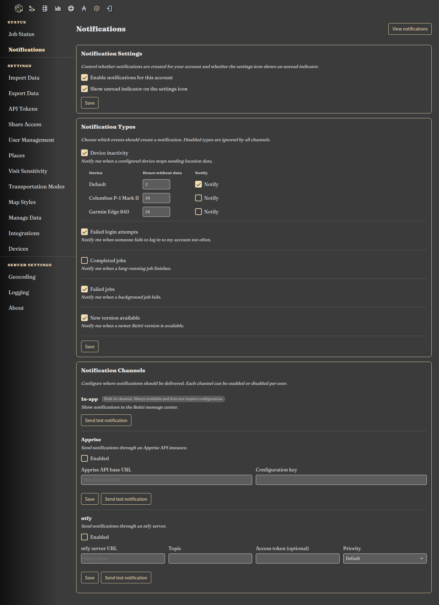
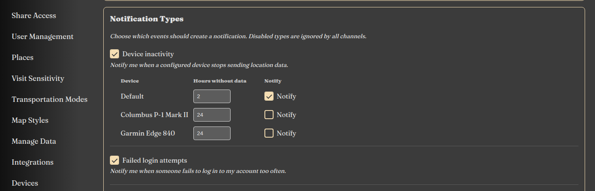

|since|v5.9.0|.version-badge|

Reitti can notify you about things that happen in the background: long-running import and processing jobs that finish or fail, new Reitti versions, failed login attempts, and devices that stop sending location data. Notifications are delivered to a **per-user inbox** inside Reitti, and can additionally be forwarded to external channels like **ntfy** and **Apprise** so you can receive them on your phone or desktop.

### How It Works

1. Something happens in Reitti (a job finishes, a new version is published, …). These events are created by *producers*.
2. Each event is rendered into a notification for the affected user.
3. The notification is delivered to every **channel** the user has enabled and configured.
4. The notification lands in the user's **inbox** and can be read, dismissed, or deleted.

Delivery is per user:

- **Notification types** decide *which events* create a notification for you.
- **Channels** decide *where* the notification is delivered.
- Both are configured individually by every user, so an admin can get version updates on their phone while other users don't see them at all.

!!! hint "Who receives what"
    Some events are targeted at specific users: job notifications go to the user who started the job, and new version notifications are only sent to **administrators**. Failed login notifications go to the owner of the account that was targeted. Device inactivity notifications go to the owner of the configured device.

### The Notification Settings

Navigate to **Settings > Notifications**. The page has three sections:

- **Notification Settings**: enable or disable notifications for your account entirely, and control whether the settings icon shows an unread indicator.
- **Notification Types**: choose which events should create a notification. Disabled types are ignored by **all** channels.
- **Notification Channels**: configure where notifications should be delivered. Each channel can be enabled or disabled per user, and each channel has a **Send test notification** button.



### Notification Types

| Type | What triggers it | Who receives it |
|:-----|:-----------------|:----------------|
| **Completed jobs** | A long-running job (import, processing, …) finished successfully. Only jobs that ran longer than the configured minimum duration trigger a notification, see [server configuration](#server-configuration). | The user who started the job |
| **Failed jobs** | A background job failed. | The user who started the job; system jobs are sent to all admins |
| **New version available** | Reitti found a newer version on GitHub. | Administrators only |
| **Failed login attempts** | Someone failed to log in to your account too often, and the account was locked. | The owner of the account |
| **Device inactivity** | A configured device has not sent any location data for the configured number of hours. | The owner of the device |
| **Test notification** | Triggered manually by the **Send test** button in the channel settings. | You |

### Device Inactivity

The **Device inactivity** type warns you when one of your devices stops sending location data.

1. Enable **Device inactivity** in **Settings > Notifications > Notification Types**.
2. A list of your devices appears directly below the type. Select the devices you want to monitor.
3. Set how many hours without data are allowed before Reitti notifies you.
4. Save the notification type settings.



Reitti sends only one notification per inactivity period. When the device starts sending data again, the state is reset, so a later inactivity period triggers a new notification. Uncheck a device to stop monitoring it. Disabling the **Device inactivity** type hides the device list and suspends all device inactivity notifications.

!!! hint "Choosing the threshold"
    Use a value that is longer than your device's normal upload interval. A phone that uploads every few minutes may be fine with 1–2 hours, while a GPS tracker that syncs once a day needs a higher threshold.

### The New Version Notification

Reitti periodically asks GitHub for the latest release and notifies administrators when it is newer than the running version.

- The check runs **once a day** (default: 4 AM) and can be rescheduled via a cron expression, see [server configuration](#server-configuration).
- The check is skipped entirely when Reitti runs a *development* build without a proper version.
- The **click action** of the notification links to the GitHub release page of the new version, e.g. `https://github.com/dedicatedcode/reitti/releases/tag/v5.8.1`.
- The last announced version is stored, so a restart does not announce the same release twice.
- If no administrator has update notifications enabled, the version is **not** marked as announced, so it will be announced as soon as an admin enables it.

### Notification Channels

#### In-app

The built-in channel. Every notification is always delivered to the user's inbox, and depending on the type it may also pop up as a toast or dialog while you are using Reitti. This channel requires no configuration.

#### ntfy

[ntfy](https://ntfy.sh) is a simple HTTP-based pub-sub notification service. Reitti publishes each notification as a JSON message to your ntfy server, and you can subscribe to the topic with any ntfy app.

| Setting | Description |
|:--------|:------------|
| **ntfy server URL** | Base URL of your ntfy server, e.g. `https://ntfy.sh` or `http://ntfy.example.com`. |
| **Topic** | The topic to publish to, e.g. `reitti-notifications`. |
| **Access token** | Optional access token if your ntfy server requires authentication. |
| **Priority** | Optional fixed priority for all messages, `1` (min) to `5` (max/urgent). When left on *Default*, the priority is derived from the notification severity: |

| Notification severity | ntfy priority |
|:----------------------|:--------------|
| Error | `5` |
| Warning | `4` |
| Success | `3` |
| Info | `3` |

#### Apprise

[Apprise](https://github.com/caronc/apprise) supports more than 100 notification services (Telegram, Discord, email, Matrix, …). Reitti talks to an [Apprise API](https://github.com/caronc/apprise-api) instance, which then fans the notification out to all services configured for your configuration key. The Apprise CLI cannot be used, only the API.

**1. Run an Apprise API instance**

```yaml
services:
  apprise:
    image: caronc/apprise:latest
    ports:
      - "8000:8000"
    environment:
      APPRISE_STATEFUL_MODE: simple
      APPRISE_DEFAULT_FORMAT: "text"
    volumes:
      - apprise-config:/config
      - apprise-attach:/attach
volumes:
  apprise-config:
  apprise-attach:
```

**2. Create a configuration with a key**

1. Open the Apprise web UI, e.g. `http://localhost:8000`.
2. Click **Configuration**, create a configuration and give it a **key**, e.g. `reitti`.
3. Add all notification service URLs you want to receive notifications from.
4. Save the configuration.

**3. Configure Reitti**

| Setting | Description |
|:--------|:------------|
| **Apprise API base URL** | Base URL of your Apprise API instance, e.g. `http://localhost:8000`. When Reitti runs in Docker, this must be reachable *from the Reitti container*, e.g. `http://apprise:8000`. |
| **Configuration key** | The key of the configuration you created above, e.g. `reitti`. |

Reitti then POSTs each notification to `<base URL>/notify/<key>`. The message severity is mapped to Apprise's notification type: Error → `failure`, Warning → `warning`, Success → `success`, Info → `info`.

Use the **Send test** button to verify the setup. If the test fails, check the Reitti server logs for the exact error.

### Links in Notifications

Some notifications link back to a relevant page in Reitti, e.g. job notifications link to the job status page:

- In the **in-app inbox** the link stays relative, so it always points to your own Reitti instance.
- External channels (ntfy, Apprise) need an **absolute** URL. Reitti therefore only attaches a click URL to external notifications when `ADVERTISE_URI` is configured (see [Docker Configuration](../infrastructure/docker-config.md#server-and-context-path)). Without it, external notifications simply have no click action.

### Server Configuration

These settings are instance-wide and are set in your `application.properties`. When running Reitti with Docker Compose, only the first two can be overridden through environment variables (see [Docker Configuration](../infrastructure/docker-config.md#notifications)).

| Property | Description | Default |
|:---------|:------------|:--------|
| `reitti.notifications.enabled` | Master switch for the whole notification system. When `false`, no notifications are created at all. | `true` |
| `reitti.notifications.update-check.enabled` | Enable or disable the periodic new version check. | `true` |
| `reitti.notifications.update-check.cron` | Cron expression controlling how often the new version check runs. | `0 0 4 * * *` (daily at 4 AM) |
| `reitti.notifications.update-check.url` | URL of the JSON endpoint that returns the latest release. Points to the official Reitti repository and only needs changing for air-gapped or mirrored setups. | `https://api.github.com/repos/dedicatedcode/reitti/releases/latest` |
| `reitti.notifications.jobs.completion-min-duration-minutes` | Minimum duration in minutes a job must run before its completion triggers a "Completed job" notification. Short jobs finish silently. | `5` |
| `reitti.notifications.device-inactivity.cron` | Cron expression controlling how often Reitti checks configured devices for missing location data. The check always runs and does nothing when no devices are configured. | `0 */15 * * * *` (every 15 minutes) |
| `reitti.notifications.external.timeout-seconds` | Connect and read timeout in seconds for delivering notifications to ntfy and Apprise. | `10` |
| `reitti.notifications.external.dispatch-threads` | Number of threads used to deliver notifications to external channels. A slow or hanging external endpoint never blocks Reitti itself. | `4` |

!!! hint "Self-hosted version check"
    If your server cannot reach `api.github.com`, point `reitti.notifications.update-check.url` to a JSON endpoint that answers with a `tag_name` field in the same shape as the [GitHub latest release API](https://docs.github.com/en/rest/releases/releases#get-the-latest-release). A version is announced when its `tag_name` is newer than the running version. Version comparison ignores a leading `v` and any suffix after a dash, so `v5.8.1` and `5.8.1-beta1` both work.

### Troubleshooting

- **No notifications arrive in the inbox**: check that notifications are enabled for your account and that the notification *type* is enabled. Types disabled in the settings are ignored by every channel.
- **No device inactivity notification arrives**: make sure the **Device inactivity** type and the specific device are enabled in the notification settings. Reitti sends only one notification per inactivity period and does not repeat it until the device sends data again.
- **Nothing arrives via ntfy/Apprise**: send a test notification from the channel settings and check the Reitti server logs. Also make sure the URL is reachable from the Reitti container (a `localhost` URL is wrong when Reitti runs in Docker, use the container/service name instead).
- **External notifications have no click link**: configure `ADVERTISE_URI` so Reitti can build absolute URLs.
- **You never received a "New version available" notification**: the check only runs on a schedule (default once per day) and only for administrators. A version that was announced before you enabled the type will not be re-announced.
