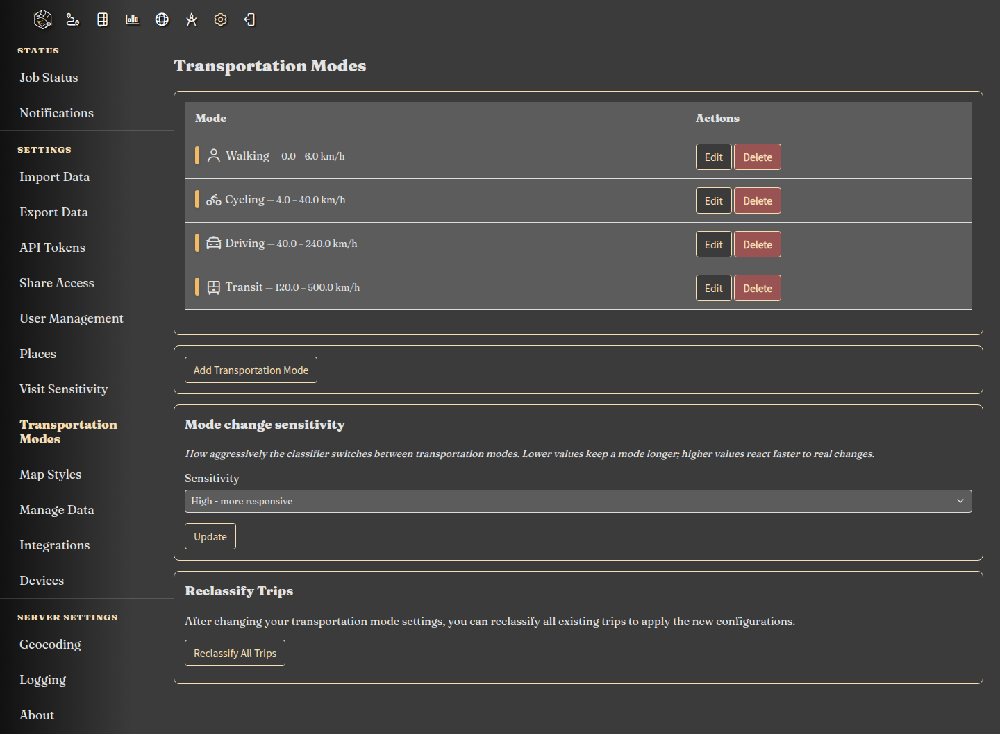
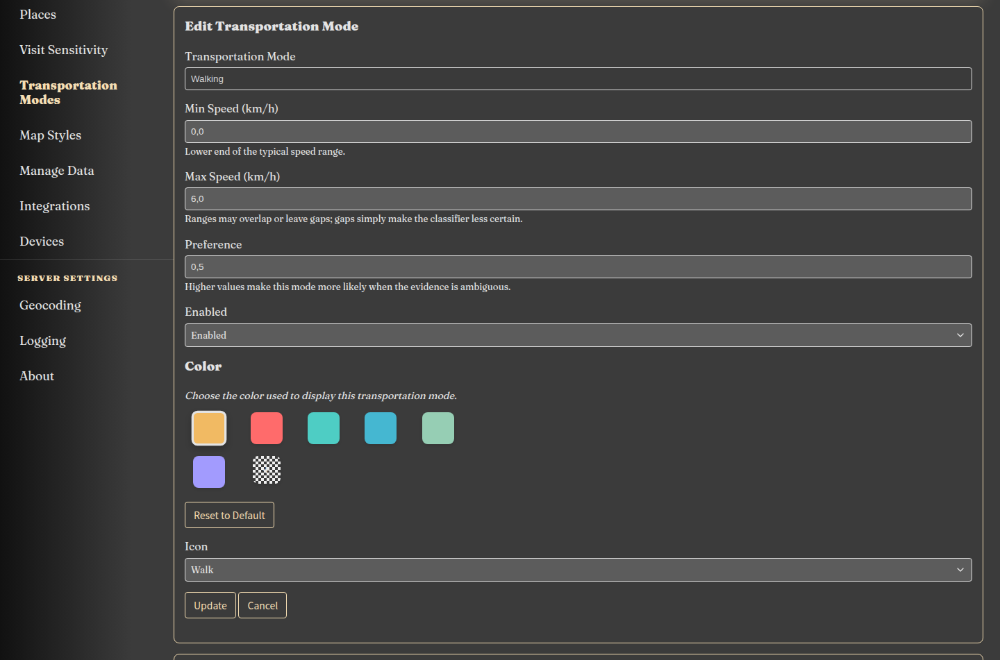
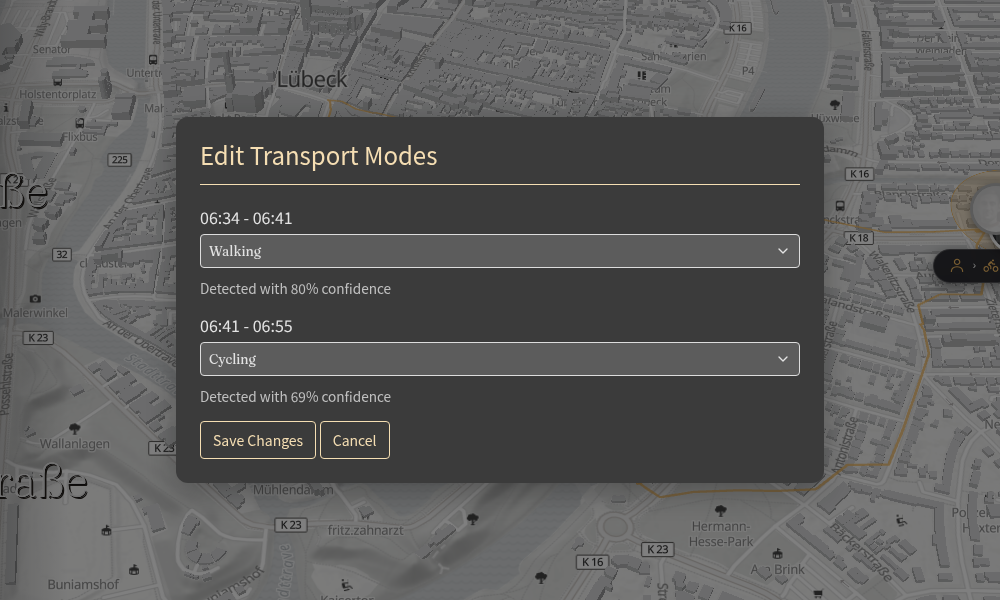

|since|v2.0.0|.version-badge|

Reitti can automatically work out how you travelled between two places. It looks at your location history and labels each part of a trip as **Walking**, **Cycling**, **Driving**, **Transit**, or another mode you have enabled.

The defaults work well for most people. If Reitti often guesses a mode wrongly, the settings on this page let you nudge it towards the way you actually travel.

## Why use transportation mode detection?

- **See how you really move** — walking, cycling, driving and public transport are separated automatically.
- **Better statistics** — distance, time and average speed are grouped by mode.
- **Clearer map** — trips can be colored by mode, with badges where you change from one mode to another.
- **Less manual work** — you only need to correct the trips Reitti gets wrong.

## How detection works

Reitti does not just look at a single speed value. For each short part of a trip it considers:

- how fast you moved,
- how steady that speed was,
- how fast you were going at your fastest moment in that part,
- and what happened before and after.

It then looks at the whole trip and tries to avoid changing modes for a short slow patch. A red light, a traffic jam, or leaving the motorway is normally kept as part of the same drive.

!!! hint "You stay in control"
    Every automatic result can be corrected. See [Correcting a trip](#correcting-a-trip) below.

## Multi-segment trips

A journey often uses more than one mode. A commute might be **Walking → Driving → Walking**. Reitti splits a trip into segments and labels each one, so the result can be a sequence such as `Walking → Driving → Walking`.

On the map, enable **Display Transportation Modes** in the map settings to color tracks by mode and show transition badges where the mode changes (see [Transportation Mode Display](../usage/main-view.md#transportation-mode-display)).

## Configuring your modes

Open **Settings > Transportation Modes**.

Each mode has its own card. Select **Edit** to change it.

### Typical speed range

Instead of a single maximum speed, each mode has a **typical speed range** — a lower and an upper number. The units follow your profile setting (km/h or mph).

Think of it as: *“When I use this mode, I usually move somewhere between these two speeds.”*

For example:

- Walking: 0–7 km/h
- Cycling: 5–25 km/h
- Driving: 20–130 km/h

The ranges are allowed to **overlap**. Walking and cycling overlap around 5–7 km/h; cycling and driving overlap around 20–25 km/h. That is normal and intentional — Reitti uses the rest of the trip to decide between them.

You can also leave a **gap** between two ranges. A gap does not break anything; it simply means Reitti is less certain about speeds that fall inside it. The settings page will still let you save the change.

!!! hint "What should I enter?"
    Use the speeds you actually see in your own trips. If you often ride an e-bike at 30 km/h, raise the upper end of **Cycling**. If you drive mostly in a city, a lower top speed for **Driving** is fine too.

### Preference

**Preference** tells Reitti how strongly it should favor a mode when the speed evidence could point to more than one mode. The allowed range is `0.1` to `5.0`.

- `1.0` is neutral. This is the default.
- Higher values (for example `1.2` or `1.5`) make the mode **more likely**.
- Lower values (for example `0.7` or `0.5`) make it **less likely**.

Use it as a gentle nudge, not a switch. For example, if you often cycle at speeds that could also be a slow car, you can raise **Cycling** slightly. If you rarely use public transport, lowering **Transit** a little helps.

!!! hint "Preference is not a guarantee"
    A very high preference cannot force a mode when the movement clearly does not match it. Keep the value close to `1.0` unless you have a specific reason to change it.

The default **Transit** preference is `0.7`, because public transport is easy to confuse with driving.

### Enabled

Turn off modes you never use. If you never take the train, disable **Train**; if you do not own a car, disable **Driving**. Fewer available modes means fewer wrong guesses.

### Color and icon

These only affect how the mode is shown on the map and in the timeline. They do not change detection.

## Mode change sensitivity

The **Mode change sensitivity** setting controls how quickly Reitti switches from one mode to another.

- **Low — fewer mode changes**: Reitti keeps a mode for longer and only switches when it is very sure. Good for commutes and long drives.
- **Medium**: the default balance.
- **High — more responsive**: Reitti switches sooner. Good for trips that genuinely mix modes, such as walking to a station and then taking a train.

If you see too many short, unlikely mode changes, choose **Low**. If a real mode change is being missed, choose **High**.

## How confident is Reitti?

When you open a trip for editing, Reitti shows how sure it is about each segment, for example **“Detected with 89% confidence”**.

- **High confidence** means the movement fitted the mode well.
- **Low confidence** means the movement could fit more than one mode. It is a good hint that the segment is worth checking.
- **Manual** means you set that segment yourself.

## Correcting a trip

If a segment is wrong:

1. Open the timeline.
2. Select the trip, hover over it and click the pencil icon.
3. Choose the correct mode for each segment.
4. Click **Save Changes**.

Your correction is remembered. When trips are recalculated later, Reitti keeps your manual choice instead of overwriting it.

## Reclassifying existing trips

Changing the settings only affects new trips by default. To apply them to trips that already exist:

1. Open **Settings > Transportation Modes**.
2. Click **Reclassify All Trips**.
3. The work runs in the background. You can follow it on the **Job Status** page.

!!! hint "Manual changes survive"
    Reclassifying does not throw away your manual corrections. They are applied again after the automatic detection.

## Getting the best results

- **Start with the defaults.** They work well for most people.
- **Adjust the typical speed range first.** It has the biggest effect.
- **Disable modes you never use.** This is often more effective than lowering a preference.
- **Use preference sparingly.** Small changes are enough.
- **Correct the obvious mistakes.** Your manual fixes are kept.
- **Reclassify after bigger changes.** It updates your history to match the new settings.

## Default settings

The table below shows the values Reitti uses for a new installation. If you upgraded from an older version, your previous maximum speeds are kept as the upper end of each range, so your numbers may look different.

| Mode        | Typical speed range | Preference |
|-------------|---------------------|------------|
| Walking     | 0–7 km/h            | 1.0        |
| Cycling     | 5–25 km/h           | 1.0        |
| Driving     | 20–130 km/h         | 1.0        |
| Transit     | 10–200 km/h         | 0.7        |
| Train       | not configured      | —          |
| Motorcycle  | not configured      | —          |
| E-Scooter   | not configured      | —          |
| Airplane    | not configured      | —          |

You can add any of the unconfigured modes with **Add Transportation Mode** if you use them.
