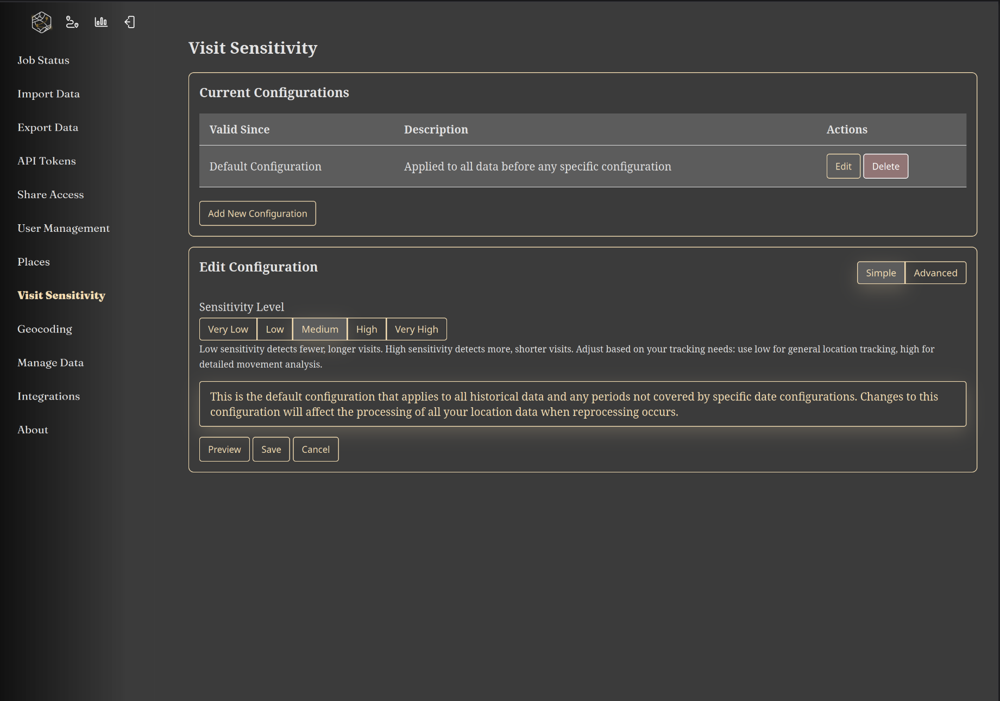
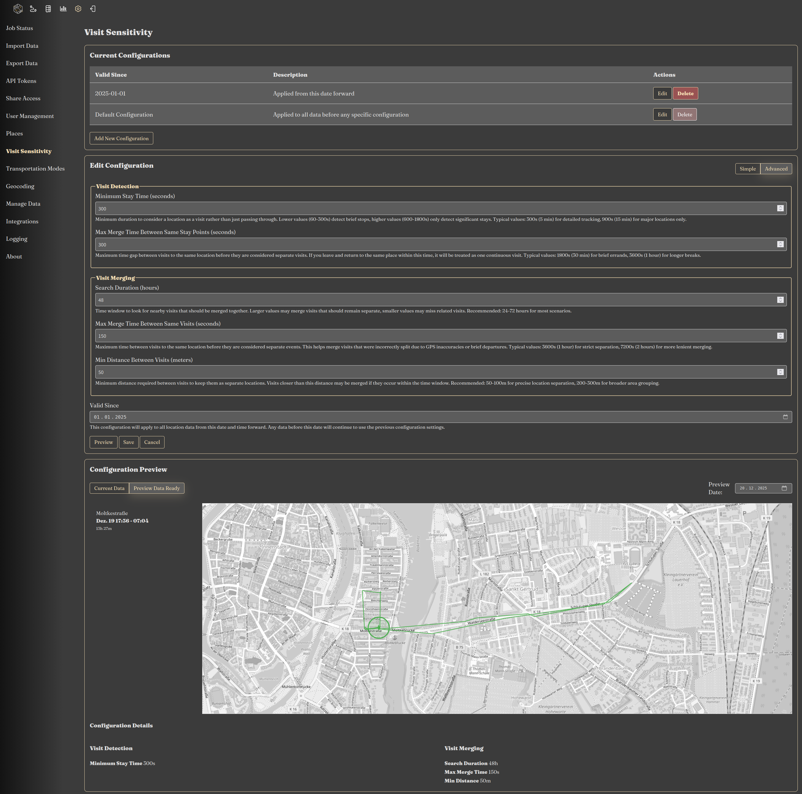

|since|v1.6.0|.version-badge|

Reitti's visit detection algorithm automatically identifies when you've stayed at a location for a significant period of time. The algorithm parameters can be customized to match your specific movement patterns and data frequency.

### Why Use Visit Detection?

Visit detection enhances your location data by:

- **Meaningful Stops**: Automatically identifies significant locations where you've spent time
- **Pattern Recognition**: Distinguishes between brief stops and actual visits
- **Data Optimization**: Reduces noise from GPS drift and brief pauses
- **Personalized Analysis**: Adapts to your unique movement patterns and lifestyle

### How It Works

1. The algorithm analyzes your location data to identify periods of minimal movement
2. Parameters like minimum duration and distance thresholds determine what constitutes a "visit"
3. Detected visits are marked, merged and can be viewed separately from your movement tracks

### Configuration

To configure visit detection:

1. Navigate to **Settings > Visit Sensitivity**
2. Choose between **Simple Mode** or **Advanced Mode**
3. Configure your preferred settings
4. Use the preview functionality to test your configuration
5. Save your settings to apply the new parameters

!!! hint "Fine-tune your timeline"
    The **Visit Sensitivity** page also provides an **Open Place Editor** button. It takes you directly to the [Place Editor](../usage/place-edit.md), where you can delete single visits, create [No-Visit Zones](../usage/place-edit.md#no-visit-zones), and restore [suppressed visits](../usage/place-edit.md#suppressed-visits).

### Configuration Modes

#### Simple Mode

Simple mode offers five predefined presets optimized for different use cases.

#### Advanced Mode

Advanced mode allows fine-tuning of individual parameters:

- **Minimum Duration**: How long you must stay to register a visit
- **Distance Threshold**: Maximum movement radius during a visit
- **Time Window**: Period for analyzing movement patterns
- **GPS Accuracy**: Filtering based on location precision
- **Custom Rules**: Additional criteria for specific scenarios

### Features

- **Live Preview**: See how settings affect your existing data before applying
- **Automatic Recalculation**: Reitti detects when historical data needs reprocessing and asks you if you want to start a recalculation.

### Best Practices

- **Start with Simple Mode**: Use presets before moving to advanced configuration
- **Use Preview**: Always test settings with the preview before applying
- **Consider Data Frequency**: Higher frequency data allows for finer parameter tuning

### Data Frequency Guidelines

The optimal parameters depend on how frequently location data is recorded:

- **High Frequency** (every 10 seconds): Use sensitive settings with shorter durations
- **Medium Frequency** (every 15 seconds): Balanced settings work well
- **Low Frequency** (every 30 seconds): Conservative settings prevent false detections

Once configured, visit detection will automatically process your location data to identify meaningful stops and enhance your location timeline analysis.

### Sparse Data Handling

Apps that conserve battery often report a point only when they detect movement. If you spent
six hours at your desk and Reitti received two points for that time, a long stay is
indistinguishable from a gap in your data unless something fills it.

Reitti fills gaps between two reported points based on how fast you could plausibly have
covered the distance between them:

| Implied speed between the two points | What Reitti does |
|:------------------------------------|:------------------|
| At or below `MAX_STATIONARY_SPEED_KMH` (default `1.0 km/h`) | Treats the whole gap as a stay, so it is detected as one visit |
| Faster, but no longer than `MAX_INTERPOLATION_GAP_HOURS` (default `12 h`) | Treats the gap as movement and draws a straight line between the two points |
| Faster **and** longer than that | Leaves the gap empty, because the real route is unknown |

A stationary fill runs the full length of the gap, so a long stay is detected as a single
visit rather than being split by empty stretches.

These two settings are server-wide environment variables rather than per-user settings,
documented in the [Docker Configuration](../infrastructure/docker-config.md#data-import--processing).
Lower them only if you see stays being missed; raise them only if visits are appearing where you
know you were travelling.

!!! hint "Seeing more visits than you expect?"
    An interval where you were actually driving can be misread as a stay when the device reported
    few points. Raising `MAX_STATIONARY_SPEED_KMH` makes Reitti less eager to treat slow gaps as
    stationary. Delete individual visits that are wrong in the [Place Editor](../usage/place-edit.md).

