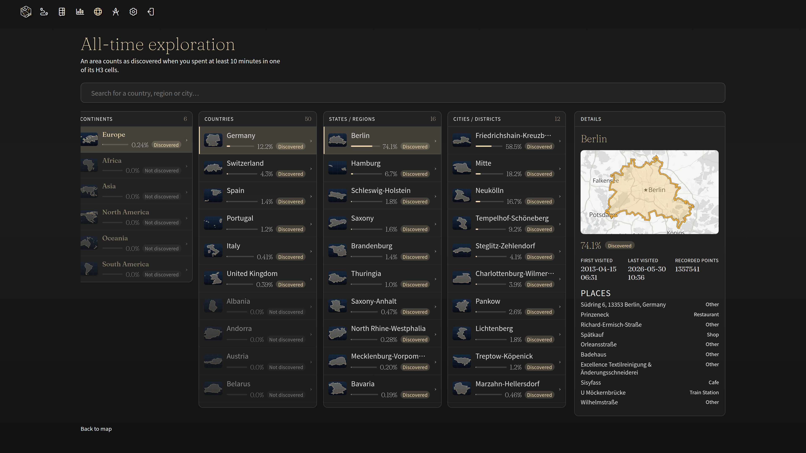
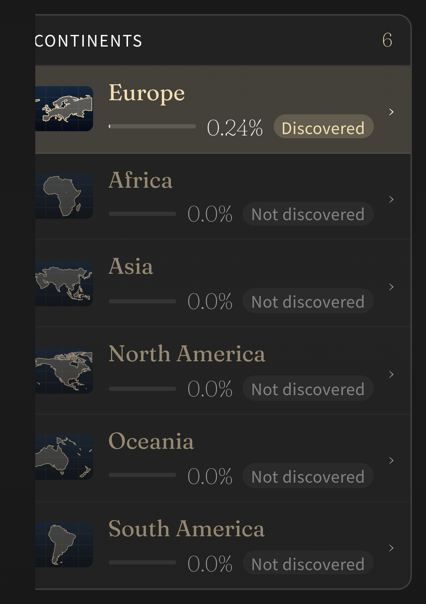
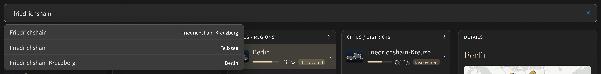
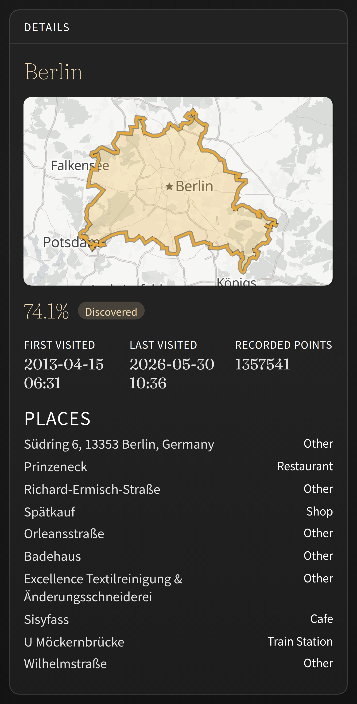

|since|v5.11.0|.version-badge|

The **All-time exploration** page answers one question: where have I already been, and where not? Instead of drawing
hexagons on a map, it lists the administrative areas of your history level by level, so you can walk from a continent
down to the districts of a city.

It is reached from the map-based [spatial coverage](../configurations/spatial-coverage.md) page: open **Coverage** in
the main menu and click **Show all** in the area explorer on the right.

The page always uses your complete history. Use the time slider on the coverage map when you want to see how your
coverage grew over time.

## Reading the columns

Each column shows one level of the hierarchy:

- **Continents**
- **Countries**
- **States / Regions**
- **Cities / Districts**
- **Sub-areas**

Selecting an area opens the next level in a column to the right and keeps the higher levels visible, so you always see
where you are.

Every entry shows a preview of the area, its name, a progress bar with the covered share, and a badge:

- **Discovered** — you have been there. The area was recorded long enough to count (see below).
- **Not discovered** — no visit was recorded yet. The entry stays in the list on purpose: the gaps are the point of
  this page.
- **›** — the area has sub-areas. Select it to open the next column.
- **Show all …** — appears below a column when a level has more areas than are listed by default; it expands the
  column.

Areas are sorted with the discovered ones first, and by covered share inside each group, so the places you know best
are at the top.

## Discovered vs. covered

The two signals answer different questions:

- The **percentage** is the share of the area's hexagon cells that you have visited, compared with all cells of the
  area. It tells you how thoroughly you explored it.
- The **Discovered** badge only tells you whether the area was visited at all. An area counts as discovered when you
  spent at least 10 minutes in one of its H3 cells. This bubbles up: a country is discovered as soon as one of its
  cities is.

That is why a country can show a small share such as `0.41%` and still be marked as discovered — you were there, but
only in a small part of it.

## Search

The search field jumps straight to any area, independent of the columns currently open. Type part of a name — the
matching also tolerates small typos — and pick one of the results. Each result shows the area name and its parent, so
places with the same name can be told apart.

## Details

The panel on the right describes the selected area:

- a small map with the boundary of the area,
- the covered share and the discovery badge,
- **first visited** and **last visited**,
- the number of **recorded points** inside the area,
- the **places** inside the area, for example your home, restaurants or train stations.

All values are aggregated over the area: selecting a country includes all of its regions, and selecting a region
includes all of its cities.

## Users and devices

If your instance has more than one user, or a user with more than one device, chips above the columns let you switch
between them. The columns and the details always show the selected combination. With a single user and a single device
the selection is hidden.

## Back to the map

**Back to map** at the bottom left returns to the map-based coverage view with the hexagons, the time slider and the
area explorer.
